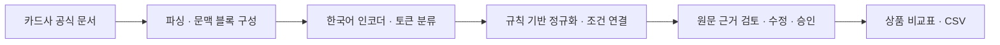

# 카드봐줘체리 · Card Cherry

**카드사 시장조사를 위한 신용카드 혜택 조건 추출·근거 검토·비교 AI**

카드 상품설명서에서 혜택 조건을 찾아 같은 기준으로 정리하고, 원문을 확인하면서 경쟁상품 조사표를 만드는 프로젝트입니다.
대학교 AI 실무 프로젝트로 진행하며, 현재는 **기획 및 개발 준비 단계**입니다. 아래 기능과 성능 수치는 구현·검증할 목표입니다.

## 왜 만드는가

카드 상품을 비교할 때는 할인율뿐 아니라 전월 실적, 월 한도, 제외 거래를 함께 확인해야 합니다.
이 조건들은 상품설명서의 본문·표·공통 유의사항에 나뉘어 있어, 여러 상품을 비교표로 정리하는 데 반복적인 확인이 필요합니다.
특히 전용 한도와 공유 한도, 실적 제외와 혜택 제외를 혼동하면 같은 수치도 다르게 해석할 수 있습니다.

카드봐줘체리는 조건 추출과 정리를 보조하고, 담당자가 **원문 근거를 검토한 뒤 조사표를 완성**하도록 돕고자 합니다.

## 분석 범위

| 항목 | 초기 개발 범위 |
| --- | --- |
| 주요 사용자 | 카드사 상품기획·시장조사 담당자 |
| 대상 상품 | 사용량·인기도와 자료 확보 가능성을 검토해 선정할 일반 신용카드 12종 |
| 대상 혜택 | 선정 카드의 온·오프라인 결제에 적용되는 정률 할인·포인트 적립 |
| 입력 자료 | 카드사 공식 상품설명서 PDF 및 공식 상품 안내 페이지 |
| 결과물 | 원문 근거가 연결된 조건 비교표, 검토·수정 이력, CSV |

플랫폼 제휴카드, 챗봇, 개인별 카드 추천, 실제 할인액 계산은 초기 개발 범위에 포함하지 않습니다.
비교에 필요한 결제 경로와 한도 적용 범위는 조건 해석에 함께 반영합니다.
최종 대상 상품 목록과 선정 기준은 자료 수집 단계에서 확정합니다.

## 주요 기능 계획

- **조건 추출:** 대상·혜택 비율·전월 실적·혜택 한도·실적 제외·혜택 제외를 추출합니다.
- **정규화와 연결:** 금액·비율·단위·비교 연산자를 정리하고 조건을 해당 혜택에 연결합니다.
- **원문 근거 확인:** 추출 위치와 문서·페이지 등 출처를 함께 보여줍니다.
- **예외 검토:** 찾지 못한 값은 `미확인`으로 남기고, 원문에 명시된 `없음`과 구분합니다.
- **검토·승인:** 모델 원본 예측과 사용자의 수정 결과를 분리해 보관합니다.
- **비교·내보내기:** 상품 간 조건 차이를 비교하고 승인한 조사표를 CSV로 내보냅니다.

## 처리 흐름과 기술 선택



| 구성 | 적용 계획 | 선택 이유 |
| --- | --- | --- |
| 프론트엔드 | React · TypeScript | 원문·추출값·비교표를 오가며 검토하는 화면 구성 |
| 백엔드 | FastAPI · Pydantic | 모델 추론 연동과 요청·응답 형식 검증 |
| AI | PyTorch · Hugging Face Transformers | 한국어 사전학습 인코더를 조건 추출에 맞게 미세조정 |
| 후처리 | Python 규칙 | 금액·단위 변환과 명확한 조건 연결을 재현 가능하게 처리 |
| 저장소 | SQLite | 노트북 환경에서 문서·예측·검토 이력을 간단히 관리 |
| 실행 환경 | Docker · 로컬 CPU | 팀원 간 실행 환경 차이를 줄이고 자원 제약을 확인 |

KoELECTRA-Small을 초기 후보로 검토하며, 성능·처리시간·메모리를 비교해 최종 모델을 선정합니다.
추출 모델은 여섯 항목의 BIO 태그와 `O`를 포함한 **13개 라벨**을 예측합니다.
모호한 조건 연결과 자동 처리 범위를 벗어난 조항은 사용자 검토 대상으로 남깁니다.

## 데이터와 평가 계획

- 문서 문맥 블록 **250~400개** 구축을 목표로 하며, 처음 **30~50개**는 두 명이 독립 라벨링한 뒤 기준을 조정합니다.
- 상품 단위로 학습 7종·검증 2종·시험 3종을 분리합니다. 같은 상품의 PDF·HTML·개정본은 같은 분할에 둡니다.
- 동일한 입력과 후처리 조건에서 규칙 기반 Baseline과 학습 모델을 비교합니다.
- 사람의 수정 전 예측 성능과 수정 후 최종 품질을 구분해 평가합니다.

| 지표 | 목표 또는 검증 방식 |
| --- | --- |
| 조건 추출 | strict span micro-F1 **0.80 이상** 목표 |
| Baseline 대비 개선 | 규칙 기반 대비 F1 **0.03 상승(3%p)** 도전 목표 |
| CPU 추론시간 | 배치 1·256토큰 이하 문맥 블록에서 warm inference p95 **5초 이내** 목표 |
| 조건 연결 | 잘못 연결한 조건의 비율과 오류 유형 분석 |
| 업무 검토 부담 | 검토시간·수정량·누락률과 최종 품질을 함께 비교 |
| 자원 사용 | 장비 사양·메모리 사용량·문서 전체 처리시간 기록 |

위 수치는 실측 결과가 아닙니다. 표본이 작은 시험 결과를 카드시장 전체의 성능으로 일반화하지 않습니다.

## 팀 역할

| 담당 | 주요 역할 |
| --- | --- |
| 손영원 | 프로젝트 조율, AI 모델 학습, 평가·실험 설계 |
| 박세렴 | React 프론트엔드, 원문 검토·비교 화면 |
| 박서연 | FastAPI, DB, 비교·CSV API |
| 박신혁 | 문서 파싱, 규칙 기반 처리, CPU 실행 환경 |
| 공통 | 데이터 라벨링·교차 검토, 통합 점검, 문서화 |

## 개발 일정

| 목표일 | 주요 완료 기준 |
| --- | --- |
| 2026-11-01 | 수집 기준·상품 분할·라벨링 지침·Baseline·API 명세 초안 |
| 2026-11-08 | 입력부터 검토 화면까지 기본 흐름 연결 |
| 2026-11-22 | 모델·후처리 개선, 평가 설정 확정 |
| 2026-12-06 | 고정 시험셋 평가, 검토 실험, 오류 분석 |
| 2026-12-12 | 내부 구현 완료, 실행 안내·결과 보고서 정리 |

## 저장소 구조

```text
card-cherry/
├── frontend/           # React 화면 구현 공간
├── backend/            # FastAPI·DB 구현 공간
├── ml/                 # 라벨링·학습·평가 코드 구현 공간
├── scripts/            # 수집·전처리·실행 보조 스크립트
├── tests/              # 회귀·통합 검증 코드
├── data/README.md      # 데이터 관리·출처 기록 원칙
├── models/README.md    # 모델·실험 산출물 관리 원칙
├── docs/DEVELOPMENT.md # 초기 작업과 인터페이스 합의 항목
├── .github/            # 작업·버그 이슈 및 PR 양식
└── CONTRIBUTING.md     # 협업 규칙
```

개발 폴더는 초기 골격이며, 실행 가능한 서비스 코드는 순차적으로 추가합니다.

## 팀원 시작 방법

```bash
git clone https://github.com/AE0NE/card-cherry.git
cd card-cherry
git switch -c feat/issue-number-short-name
```

1. GitHub 공동 작업 초대를 수락합니다.
2. Issues에서 작업을 만들고 담당자와 완료 기준을 정합니다.
3. 작업 브랜치에서 수정한 뒤 Pull Request를 엽니다.
4. 팀원 한 명 이상이 검토한 뒤 `main`에 병합하는 방식으로 협업합니다.

브랜치 규칙은 팀 협업 원칙이며, 저장소의 강제 보호 설정 여부와는 구분합니다.
자세한 규칙은 [CONTRIBUTING.md](CONTRIBUTING.md), 첫 작업 목록은 [개발 안내](docs/DEVELOPMENT.md)를 참고하세요.
설치·실행 명령은 각 모듈 구현 시 실제 검증한 환경과 함께 추가합니다.

## 공개 및 자료 이용 원칙

- 공개할 코드·라벨링 지침·평가 방법·재현 가능한 예시를 중심으로 관리합니다.
- 고객 개인정보, API 키, `.env`, 원본 금융 문서와 모델 가중치는 기본 추적 대상에서 제외합니다.
- 공식 문서도 재배포 권한이 자동으로 주어지는 것은 아니므로, 원문은 우선 출처 URL·수집일·해시로 관리합니다.
- 공개 데이터와 모델은 각각 이용 조건을 확인하고 사용한 버전·출처·라이선스를 기록합니다.
- **프로젝트 코드의 오픈소스 라이선스는 팀 협의 후 확정해 `LICENSE`로 추가할 예정입니다.** 현재 공개 열람 가능 상태와 오픈소스 사용 허가는 구분합니다.
- 제공 결과는 상품 조건 검토를 돕는 연구용 결과이며, 최종 조건은 해당 카드사의 최신 공식 자료로 확인합니다.
