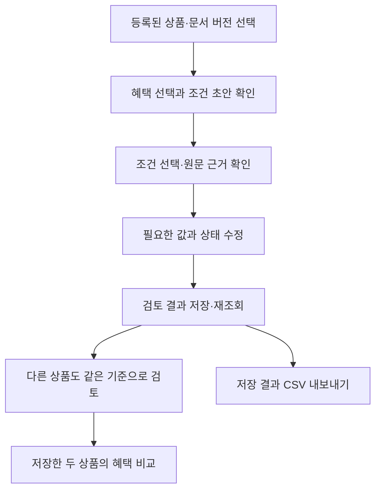

[화면기획_초안.md](https://github.com/user-attachments/files/34268119/_.md)
# 조건 검토 중심 화면 기획 초안

| 항목 | 기준 |
| --- | --- |
| 작성일 | 2026-11-02 |
| 사용자 | 카드사 상품기획·시장조사 담당자 |
| 사용 목적 | 경쟁상품 조건의 초안을 원문과 대조해 조사자료로 정리 |
| 상태 | PM 기획·Figma 논의용 초안. 최종 디자인·실제 구현 화면 아님 |
| 범위 기준 | [주 1회 협업·6주 일정 조정안](협업방식_및_6주_일정_조정안.md) |

## 1. 사용자가 끝내려는 일

담당자는 편의점 혜택을 비교하기 위해 상품 A의 할인율·전월 실적·한도·제외 조건을 확인합니다. 시스템의 초안을 읽고 원문과 다른 부분을 수정해 저장합니다. 상품 B도 같은 기준으로 검토한 뒤 두 결과를 나란히 확인하고 조사자료를 내보냅니다.

화면에서 먼저 답해야 할 질문은 다음과 같습니다.

- 지금 어떤 상품·문서 버전을 보고 있는가?
- 선택한 혜택의 조건과 원문 근거는 무엇인가?
- 미확인·검토 필요·미저장 변경은 어디에 남아 있는가?
- 저장한 결과를 다시 확인하고 다른 상품과 비교할 수 있는가?

## 2. 화면 범위와 이동 흐름

독립된 문서 목록·검토·비교 페이지를 모두 만드는 대신, **조건 검토 작업 화면 하나와 두 상품 비교 패널**로 시작합니다.

첫 입력은 백엔드에 등록된 자료를 선택하는 방식으로 단순화합니다. 파일 수집·파싱은 별도 개발 작업으로 진행하고, 첫 UI에 복잡한 문서 업로드·관리 기능을 요구하지 않습니다.

## 3. 조건 검토 작업 화면

<?xml version='1.0' encoding='utf-8'?>
<svg xmlns="http://www.w3.org/2000/svg" viewBox="0 0 1280 900" width="1280" height="900" role="img">
  <title>조건 검토 작업 화면 구성 제안</title>
  <desc>합성 문서와 여섯 조건을 대조하고 수정·저장하는 화면의 정보 구조. 미확정 와이어프레임이며 구현된 화면이 아닙니다.</desc>
  <rect x="0" y="0" width="1280" height="900" fill="#f3f5f8" stroke="none" rx="0" />
  <text x="30" y="42" font-family="-apple-system, BlinkMacSystemFont, Apple SD Gothic Neo, Malgun Gothic, sans-serif" font-size="22" fill="#273142" font-weight="600">
    <tspan x="30" dy="0">조건 검토 · 화면 구성 제안</tspan>
  </text>
  <text x="875" y="40" font-family="-apple-system, BlinkMacSystemFont, Apple SD Gothic Neo, Malgun Gothic, sans-serif" font-size="15" fill="#667184" font-weight="400">
    <tspan x="875" dy="0">합성 데이터 · 미확정 와이어프레임</tspan>
  </text>
  <rect x="30" y="68" width="1220" height="97" fill="#ffffff" stroke="#cbd2dc" rx="8" />
  <text x="50" y="95" font-family="-apple-system, BlinkMacSystemFont, Apple SD Gothic Neo, Malgun Gothic, sans-serif" font-size="14" fill="#667184" font-weight="400">
    <tspan x="50" dy="0">상품·문서</tspan>
  </text>
  <rect x="50" y="108" width="340" height="40" fill="#f8f9fb" stroke="#cbd2dc" rx="5" />
  <text x="64" y="134" font-family="-apple-system, BlinkMacSystemFont, Apple SD Gothic Neo, Malgun Gothic, sans-serif" font-size="16" fill="#273142" font-weight="400">
    <tspan x="64" dy="0">가상 상품 A · 설명자료 v1</tspan>
  </text>
  <text x="366" y="133" font-family="-apple-system, BlinkMacSystemFont, Apple SD Gothic Neo, Malgun Gothic, sans-serif" font-size="18" fill="#273142" font-weight="400">
    <tspan x="366" dy="0">⌄</tspan>
  </text>
  <text x="412" y="95" font-family="-apple-system, BlinkMacSystemFont, Apple SD Gothic Neo, Malgun Gothic, sans-serif" font-size="14" fill="#667184" font-weight="400">
    <tspan x="412" dy="0">검토할 혜택</tspan>
  </text>
  <rect x="412" y="108" width="190" height="40" fill="#f8f9fb" stroke="#cbd2dc" rx="5" />
  <text x="426" y="134" font-family="-apple-system, BlinkMacSystemFont, Apple SD Gothic Neo, Malgun Gothic, sans-serif" font-size="16" fill="#273142" font-weight="400">
    <tspan x="426" dy="0">편의점</tspan>
  </text>
  <text x="578" y="133" font-family="-apple-system, BlinkMacSystemFont, Apple SD Gothic Neo, Malgun Gothic, sans-serif" font-size="18" fill="#273142" font-weight="400">
    <tspan x="578" dy="0">⌄</tspan>
  </text>
  <text x="650" y="116" font-family="-apple-system, BlinkMacSystemFont, Apple SD Gothic Neo, Malgun Gothic, sans-serif" font-size="14" fill="#667184" font-weight="400">
    <tspan x="650" dy="0">문서: SYN-UI-A</tspan>
  </text>
  <text x="650" y="140" font-family="-apple-system, BlinkMacSystemFont, Apple SD Gothic Neo, Malgun Gothic, sans-serif" font-size="14" fill="#667184" font-weight="400">
    <tspan x="650" dy="0">검토 버전: 저장 전</tspan>
  </text>
  <rect x="1060" y="108" width="166" height="40" fill="#ffffff" stroke="#cbd2dc" rx="6" />
  <text x="1075" y="134" font-family="-apple-system, BlinkMacSystemFont, Apple SD Gothic Neo, Malgun Gothic, sans-serif" font-size="15" fill="#273142" font-weight="500">
    <tspan x="1075" dy="0">두 상품 비교</tspan>
  </text>
  <rect x="30" y="184" width="552" height="566" fill="#ffffff" stroke="#cbd2dc" rx="8" />
  <text x="50" y="218" font-family="-apple-system, BlinkMacSystemFont, Apple SD Gothic Neo, Malgun Gothic, sans-serif" font-size="18" fill="#273142" font-weight="600">
    <tspan x="50" dy="0">원문과 근거</tspan>
  </text>
  <text x="50" y="246" font-family="-apple-system, BlinkMacSystemFont, Apple SD Gothic Neo, Malgun Gothic, sans-serif" font-size="14" fill="#667184" font-weight="400">
    <tspan x="50" dy="0">합성문서 A · 블록 SYN-UI-A01</tspan>
  </text>
  <line x1="50" y1="265" x2="562" y2="265" stroke="#dce1e8" />
  <rect x="46" y="326" width="520" height="45" fill="#eaf0fe" stroke="none" rx="5" />
  <text x="58" y="307" font-family="-apple-system, BlinkMacSystemFont, Apple SD Gothic Neo, Malgun Gothic, sans-serif" font-size="16" fill="#273142" font-weight="400">
    <tspan x="58" dy="0">편의점 결제 시 10%, 카페 결제 시 5% 할인됩니다.</tspan>
  </text>
  <text x="58" y="352" font-family="-apple-system, BlinkMacSystemFont, Apple SD Gothic Neo, Malgun Gothic, sans-serif" font-size="16" fill="#273142" font-weight="400">
    <tspan x="58" dy="0">전월 이용실적 30만 원 이상인 경우 제공됩니다.</tspan>
  </text>
  <text x="58" y="397" font-family="-apple-system, BlinkMacSystemFont, Apple SD Gothic Neo, Malgun Gothic, sans-serif" font-size="16" fill="#273142" font-weight="400">
    <tspan x="58" dy="0">편의점과 카페 할인은 합산하여</tspan>
  </text>
  <text x="58" y="442" font-family="-apple-system, BlinkMacSystemFont, Apple SD Gothic Neo, Malgun Gothic, sans-serif" font-size="16" fill="#273142" font-weight="400">
    <tspan x="58" dy="0">월 최대 5천 원까지 제공됩니다.</tspan>
  </text>
  <text x="58" y="487" font-family="-apple-system, BlinkMacSystemFont, Apple SD Gothic Neo, Malgun Gothic, sans-serif" font-size="16" fill="#273142" font-weight="400">
    <tspan x="58" dy="0">상품권 구매금액은 전월 실적에서 제외됩니다.</tspan>
  </text>
  <text x="58" y="532" font-family="-apple-system, BlinkMacSystemFont, Apple SD Gothic Neo, Malgun Gothic, sans-serif" font-size="16" fill="#273142" font-weight="400">
    <tspan x="58" dy="0">간편결제 거래에는 할인이 적용되지 않습니다.</tspan>
  </text>
  <line x1="50" y1="594" x2="562" y2="594" stroke="#dce1e8" />
  <text x="50" y="627" font-family="-apple-system, BlinkMacSystemFont, Apple SD Gothic Neo, Malgun Gothic, sans-serif" font-size="15" fill="#245bd6" font-weight="500">
    <tspan x="50" dy="0">선택한 조건: 전월 실적</tspan>
  </text>
  <text x="50" y="659" font-family="-apple-system, BlinkMacSystemFont, Apple SD Gothic Neo, Malgun Gothic, sans-serif" font-size="15" fill="#273142" font-weight="400">
    <tspan x="50" dy="0">조건 선택 → 해당 블록·원문 구간 확인</tspan>
  </text>
  <text x="50" y="704" font-family="-apple-system, BlinkMacSystemFont, Apple SD Gothic Neo, Malgun Gothic, sans-serif" font-size="14" fill="#667184" font-weight="400">
    <tspan x="50" dy="0">출처: 직접 만든 설명용 문구</tspan>
  </text>
  <rect x="602" y="184" width="648" height="566" fill="#ffffff" stroke="#cbd2dc" rx="8" />
  <text x="624" y="218" font-family="-apple-system, BlinkMacSystemFont, Apple SD Gothic Neo, Malgun Gothic, sans-serif" font-size="18" fill="#273142" font-weight="600">
    <tspan x="624" dy="0">혜택 조건</tspan>
  </text>
  <text x="943" y="218" font-family="-apple-system, BlinkMacSystemFont, Apple SD Gothic Neo, Malgun Gothic, sans-serif" font-size="14" fill="#667184" font-weight="400">
    <tspan x="943" dy="0">사람의 검토: 미완료</tspan>
  </text>
  <text x="624" y="250" font-family="-apple-system, BlinkMacSystemFont, Apple SD Gothic Neo, Malgun Gothic, sans-serif" font-size="13" fill="#667184" font-weight="400">
    <tspan x="624" dy="0">항목</tspan>
  </text>
  <text x="770" y="250" font-family="-apple-system, BlinkMacSystemFont, Apple SD Gothic Neo, Malgun Gothic, sans-serif" font-size="13" fill="#667184" font-weight="400">
    <tspan x="770" dy="0">정리한 값 · 적용 범위</tspan>
  </text>
  <text x="1155" y="250" font-family="-apple-system, BlinkMacSystemFont, Apple SD Gothic Neo, Malgun Gothic, sans-serif" font-size="13" fill="#667184" font-weight="400">
    <tspan x="1155" dy="0">확인 상태</tspan>
  </text>
  <line x1="620" y1="270" x2="1232" y2="270" stroke="#dce1e8" />
  <text x="624" y="303" font-family="-apple-system, BlinkMacSystemFont, Apple SD Gothic Neo, Malgun Gothic, sans-serif" font-size="15" fill="#273142" font-weight="400">
    <tspan x="624" dy="0">대상</tspan>
  </text>
  <text x="770" y="303" font-family="-apple-system, BlinkMacSystemFont, Apple SD Gothic Neo, Malgun Gothic, sans-serif" font-size="15" fill="#273142" font-weight="400">
    <tspan x="770" dy="0">편의점</tspan>
  </text>
  <text x="1155" y="303" font-family="-apple-system, BlinkMacSystemFont, Apple SD Gothic Neo, Malgun Gothic, sans-serif" font-size="13" fill="#667184" font-weight="400">
    <tspan x="1155" dy="0">추출됨</tspan>
  </text>
  <line x1="620" y1="338" x2="1232" y2="338" stroke="#dce1e8" />
  <text x="624" y="371" font-family="-apple-system, BlinkMacSystemFont, Apple SD Gothic Neo, Malgun Gothic, sans-serif" font-size="15" fill="#273142" font-weight="400">
    <tspan x="624" dy="0">혜택 비율</tspan>
  </text>
  <text x="770" y="371" font-family="-apple-system, BlinkMacSystemFont, Apple SD Gothic Neo, Malgun Gothic, sans-serif" font-size="15" fill="#273142" font-weight="400">
    <tspan x="770" dy="0">10% · 할인</tspan>
  </text>
  <text x="1155" y="371" font-family="-apple-system, BlinkMacSystemFont, Apple SD Gothic Neo, Malgun Gothic, sans-serif" font-size="13" fill="#667184" font-weight="400">
    <tspan x="1155" dy="0">추출됨</tspan>
  </text>
  <rect x="616" y="406" width="620" height="68" fill="#edf2ff" stroke="none" rx="0" />
  <line x1="620" y1="406" x2="1232" y2="406" stroke="#dce1e8" />
  <text x="624" y="439" font-family="-apple-system, BlinkMacSystemFont, Apple SD Gothic Neo, Malgun Gothic, sans-serif" font-size="15" fill="#273142" font-weight="400">
    <tspan x="624" dy="0">전월 실적</tspan>
  </text>
  <rect x="758" y="418" width="310" height="43" fill="#ffffff" stroke="#245bd6" rx="4" />
  <text x="770" y="439" font-family="-apple-system, BlinkMacSystemFont, Apple SD Gothic Neo, Malgun Gothic, sans-serif" font-size="15" fill="#273142" font-weight="400">
    <tspan x="770" dy="0">30만 원 이상</tspan>
  </text>
  <text x="1155" y="439" font-family="-apple-system, BlinkMacSystemFont, Apple SD Gothic Neo, Malgun Gothic, sans-serif" font-size="13" fill="#667184" font-weight="400">
    <tspan x="1155" dy="0">검토 필요</tspan>
  </text>
  <line x1="620" y1="474" x2="1232" y2="474" stroke="#dce1e8" />
  <text x="624" y="507" font-family="-apple-system, BlinkMacSystemFont, Apple SD Gothic Neo, Malgun Gothic, sans-serif" font-size="15" fill="#273142" font-weight="400">
    <tspan x="624" dy="0">혜택 한도</tspan>
  </text>
  <text x="770" y="499" font-family="-apple-system, BlinkMacSystemFont, Apple SD Gothic Neo, Malgun Gothic, sans-serif" font-size="15" fill="#273142" font-weight="400">
    <tspan x="770" dy="0">월 5천 원</tspan>
    <tspan x="770" dy="24.75">편의점·카페 합산</tspan>
  </text>
  <text x="1155" y="507" font-family="-apple-system, BlinkMacSystemFont, Apple SD Gothic Neo, Malgun Gothic, sans-serif" font-size="13" fill="#667184" font-weight="400">
    <tspan x="1155" dy="0">추출됨</tspan>
  </text>
  <line x1="620" y1="542" x2="1232" y2="542" stroke="#dce1e8" />
  <text x="624" y="575" font-family="-apple-system, BlinkMacSystemFont, Apple SD Gothic Neo, Malgun Gothic, sans-serif" font-size="15" fill="#273142" font-weight="400">
    <tspan x="624" dy="0">실적 제외</tspan>
  </text>
  <text x="770" y="575" font-family="-apple-system, BlinkMacSystemFont, Apple SD Gothic Neo, Malgun Gothic, sans-serif" font-size="15" fill="#273142" font-weight="400">
    <tspan x="770" dy="0">상품권 구매금액</tspan>
  </text>
  <text x="1155" y="575" font-family="-apple-system, BlinkMacSystemFont, Apple SD Gothic Neo, Malgun Gothic, sans-serif" font-size="13" fill="#667184" font-weight="400">
    <tspan x="1155" dy="0">추출됨</tspan>
  </text>
  <line x1="620" y1="610" x2="1232" y2="610" stroke="#dce1e8" />
  <text x="624" y="643" font-family="-apple-system, BlinkMacSystemFont, Apple SD Gothic Neo, Malgun Gothic, sans-serif" font-size="15" fill="#273142" font-weight="400">
    <tspan x="624" dy="0">혜택 제외</tspan>
  </text>
  <text x="770" y="643" font-family="-apple-system, BlinkMacSystemFont, Apple SD Gothic Neo, Malgun Gothic, sans-serif" font-size="15" fill="#273142" font-weight="400">
    <tspan x="770" dy="0">간편결제 거래</tspan>
  </text>
  <text x="1155" y="643" font-family="-apple-system, BlinkMacSystemFont, Apple SD Gothic Neo, Malgun Gothic, sans-serif" font-size="13" fill="#667184" font-weight="400">
    <tspan x="1155" dy="0">추출됨</tspan>
  </text>
  <text x="624" y="716" font-family="-apple-system, BlinkMacSystemFont, Apple SD Gothic Neo, Malgun Gothic, sans-serif" font-size="14" fill="#667184" font-weight="400">
    <tspan x="624" dy="0">최초 예측 보기  +</tspan>
  </text>
  <rect x="30" y="772" width="1220" height="75" fill="#ffffff" stroke="#cbd2dc" rx="8" />
  <text x="50" y="817" font-family="-apple-system, BlinkMacSystemFont, Apple SD Gothic Neo, Malgun Gothic, sans-serif" font-size="15" fill="#273142" font-weight="400">
    <tspan x="50" dy="0">미저장 변경 1건 · 저장 성공 후 결과를 다시 확인합니다.</tspan>
  </text>
  <rect x="794" y="790" width="104" height="40" fill="#ffffff" stroke="#cbd2dc" rx="6" />
  <text x="809" y="816" font-family="-apple-system, BlinkMacSystemFont, Apple SD Gothic Neo, Malgun Gothic, sans-serif" font-size="15" fill="#273142" font-weight="500">
    <tspan x="809" dy="0">수정 취소</tspan>
  </text>
  <rect x="912" y="790" width="130" height="40" fill="#245bd6" stroke="#245bd6" rx="6" />
  <text x="927" y="816" font-family="-apple-system, BlinkMacSystemFont, Apple SD Gothic Neo, Malgun Gothic, sans-serif" font-size="15" fill="#ffffff" font-weight="500">
    <tspan x="927" dy="0">변경 저장</tspan>
  </text>
  <rect x="1056" y="790" width="170" height="40" fill="#f0f2f5" stroke="#cbd2dc" rx="6" />
  <text x="1071" y="816" font-family="-apple-system, BlinkMacSystemFont, Apple SD Gothic Neo, Malgun Gothic, sans-serif" font-size="15" fill="#7a8493" font-weight="500">
    <tspan x="1071" dy="0">CSV 내보내기</tspan>
  </text>
  <text x="30" y="880" font-family="-apple-system, BlinkMacSystemFont, Apple SD Gothic Neo, Malgun Gothic, sans-serif" font-size="14" fill="#667184" font-weight="400">
    <tspan x="30" dy="0">구성 논의용 예시 · 상세 배치와 상태 표현은 Figma 검토로 구체화합니다.</tspan>
  </text>
</svg>

그림은 정보 구조를 설명하는 구성 제안입니다. 배치·간격·색상·상호작용의 상세 설계는 박세렴의 Figma 작업과 팀 검토로 정합니다. 그림 속 상품과 문구는 모두 합성 예시입니다.

| 영역 | 보여줄 내용 | 사용 동작 |
| --- | --- | --- |
| 상단 문서 정보 | 상품·문서 버전·출처, 저장된 검토 버전 | 등록 상품·문서 선택, 출처 확인 |
| 혜택 선택 | 편의점·카페 등 현재 문서의 혜택 | 검토할 혜택을 하나 선택 |
| 원문 영역 | 보존한 블록 텍스트, 제목·표 문맥, 확인 가능한 위치 | 조건 선택에 따라 해당 근거 확인 |
| 조건 영역 | 여섯 조건의 원문·정리한 값·확인 상태 | 값 확인·수정, 미확인·검토 필요 구분 |
| 관계 표시 | 전용·공유 한도와 적용 대상 | 예: 편의점·카페가 같은 한도를 참조하는지 확인 |
| 작업 영역 | 변경 저장·취소, 미저장·저장 중·실패 안내 | 저장·재조회, 저장한 결과의 CSV 내보내기 |

문서 선택은 간단한 선택 목록으로 시작합니다. 첫 주에는 검색·정렬·대시보드를 추가하지 않습니다. 원문은 텍스트 블록으로 제공하며 PDF 위에 정밀한 사각형을 그리는 기능은 후순위입니다.

### 여섯 조건의 표시 예시

다음은 설명을 위해 만든 가상 상품 A의 조건입니다.

| 조건 | 화면에 보여줄 예시 | 원문 확인에서 주의할 점 |
| --- | --- | --- |
| 대상 | 편의점 | 제외 대상과 혼동하지 않음 |
| 혜택 비율 | 10% 할인 | 포인트 적립과 종류 구분 |
| 전월 실적 | 30만 원 이상 | 금액·단위·비교 기준 보존 |
| 혜택 한도 | 월 5천 원, 편의점·카페 합산 | 각 혜택의 독립 한도처럼 표시하지 않음 |
| 실적 제외 | 상품권 구매금액 | 혜택 제외와 별도 표시 |
| 혜택 제외 | 간편결제 거래 | 실적 제외와 별도 표시 |

조건마다 원문과 정리한 값의 역할을 구분합니다. 예를 들어 원문 `30만 원 이상`과 정규화한 금액 `300000원`·연산자 `이상`을 혼동하지 않게 설계합니다. 첫 편집 UI의 구체적인 입력 항목은 백엔드 형식과 함께 확인합니다.

## 4. Figma에서 먼저 확인할 상태

첫 주에는 같은 검토 화면의 **기본 초안 상태와 수정 후 미저장 상태**를 와이어프레임으로 표현합니다. 다른 예외는 우선 주석·설명으로 정리하고, 다음 주에 핵심 상태를 상세화합니다.

| 상태 | 화면이 알려줘야 할 내용 | 첫 주 표현 범위 |
| --- | --- | --- |
| 기본 초안 | 현재 상품·혜택·조건·원문·검토 유무 | 와이어프레임 |
| 수정 후 미저장 | 어떤 항목이 바뀌었고 아직 저장되지 않았는지 | 와이어프레임 |
| 미확인·검토 필요 | 찾지 못함과 모호한 범위 | 기본 화면의 상태 예시·주석 |
| 저장 중·성공·실패 | 실제 저장 여부, 실패 시 초안 유지 | 상태 문구·버튼 동작 주석 |
| 조회 중·빈 결과·처리 실패 | 기다리는 중인지, 데이터가 없는지, 실패인지 | 설명·확인 질문 |
| 문서 변경 전 미저장 | 저장·취소를 결정해야 함 | 동작 설명 |

색상에만 의미를 맡기지 않고 상태 문구를 함께 둡니다. 저장은 승인과 다른 동작입니다. 미확인을 검토한 뒤에도 실제 값이 확인되지 않았다면 그 상태를 유지합니다. 숫자 0·명시적 없음·미확인도 구분합니다.

최초 예측·저장된 검토 결과·편집 중 초안은 서로 다른 정보입니다. 처음부터 복잡한 이력 관리 페이지를 만들 필요는 없지만, 최초 예측을 확인할 간단한 펼침 영역 등을 검토합니다. 서버는 원래 예측을 보존합니다.

## 5. 두 상품 비교 패널

![Uploading c<?xml version='1.0' encoding='utf-8'?>
<svg xmlns="http://www.w3.org/2000/svg" viewBox="0 0 1280 854" width="1280" height="854" role="img">
  <title>저장한 두 상품의 혜택 비교 패널 구성 제안</title>
  <desc>합성 상품 A와 B의 같은 업종 혜택을 비교하는 읽기 전용 표. 할인과 포인트, 전용·공유 한도, 미확인을 구분합니다.</desc>
  <rect x="0" y="0" width="1280" height="854" fill="#f3f5f8" stroke="none" rx="0" />
  <text x="30" y="42" font-family="-apple-system, BlinkMacSystemFont, Apple SD Gothic Neo, Malgun Gothic, sans-serif" font-size="22" fill="#273142" font-weight="600">
    <tspan x="30" dy="0">두 상품 비교 · 같은 작업 화면의 패널 제안</tspan>
  </text>
  <text x="875" y="40" font-family="-apple-system, BlinkMacSystemFont, Apple SD Gothic Neo, Malgun Gothic, sans-serif" font-size="15" fill="#667184" font-weight="400">
    <tspan x="875" dy="0">합성 데이터 · 미확정 와이어프레임</tspan>
  </text>
  <rect x="60" y="80" width="1160" height="708" fill="#ffffff" stroke="#cbd2dc" rx="8" />
  <text x="86" y="120" font-family="-apple-system, BlinkMacSystemFont, Apple SD Gothic Neo, Malgun Gothic, sans-serif" font-size="20" fill="#273142" font-weight="600">
    <tspan x="86" dy="0">저장한 두 상품 비교</tspan>
  </text>
  <text x="86" y="150" font-family="-apple-system, BlinkMacSystemFont, Apple SD Gothic Neo, Malgun Gothic, sans-serif" font-size="15" fill="#667184" font-weight="400">
    <tspan x="86" dy="0">상품별로 선택한 혜택과 저장된 검토 버전을 확인합니다.</tspan>
  </text>
  <rect x="1112" y="101" width="82" height="40" fill="#ffffff" stroke="#cbd2dc" rx="6" />
  <text x="1127" y="127" font-family="-apple-system, BlinkMacSystemFont, Apple SD Gothic Neo, Malgun Gothic, sans-serif" font-size="15" fill="#273142" font-weight="500">
    <tspan x="1127" dy="0">닫기</tspan>
  </text>
  <rect x="86" y="174" width="1108" height="500" fill="#ffffff" stroke="#cbd2dc" rx="0" />
  <rect x="86" y="174" width="1108" height="54" fill="#eef1f6" stroke="none" rx="0" />
  <text x="104" y="208" font-family="-apple-system, BlinkMacSystemFont, Apple SD Gothic Neo, Malgun Gothic, sans-serif" font-size="15" fill="#273142" font-weight="600">
    <tspan x="104" dy="0">비교 항목</tspan>
  </text>
  <text x="296" y="197" font-family="-apple-system, BlinkMacSystemFont, Apple SD Gothic Neo, Malgun Gothic, sans-serif" font-size="16" fill="#273142" font-weight="600">
    <tspan x="296" dy="0">가상 상품 A · 편의점</tspan>
  </text>
  <text x="296" y="219" font-family="-apple-system, BlinkMacSystemFont, Apple SD Gothic Neo, Malgun Gothic, sans-serif" font-size="12" fill="#667184" font-weight="400">
    <tspan x="296" dy="0">문서 v1 / 저장 검토 1</tspan>
  </text>
  <text x="752" y="197" font-family="-apple-system, BlinkMacSystemFont, Apple SD Gothic Neo, Malgun Gothic, sans-serif" font-size="16" fill="#273142" font-weight="600">
    <tspan x="752" dy="0">가상 상품 B · 편의점</tspan>
  </text>
  <text x="752" y="219" font-family="-apple-system, BlinkMacSystemFont, Apple SD Gothic Neo, Malgun Gothic, sans-serif" font-size="12" fill="#667184" font-weight="400">
    <tspan x="752" dy="0">문서 v1 / 저장 검토 1</tspan>
  </text>
  <line x1="86" y1="228" x2="1194" y2="228" stroke="#dce1e8" />
  <text x="104" y="262" font-family="-apple-system, BlinkMacSystemFont, Apple SD Gothic Neo, Malgun Gothic, sans-serif" font-size="15" fill="#273142" font-weight="400">
    <tspan x="104" dy="0">혜택 종류</tspan>
  </text>
  <text x="296" y="262" font-family="-apple-system, BlinkMacSystemFont, Apple SD Gothic Neo, Malgun Gothic, sans-serif" font-size="15" fill="#273142" font-weight="400">
    <tspan x="296" dy="0">할인</tspan>
  </text>
  <text x="752" y="262" font-family="-apple-system, BlinkMacSystemFont, Apple SD Gothic Neo, Malgun Gothic, sans-serif" font-size="15" fill="#273142" font-weight="400">
    <tspan x="752" dy="0">포인트 적립</tspan>
  </text>
  <line x1="86" y1="283" x2="1194" y2="283" stroke="#dce1e8" />
  <text x="104" y="317" font-family="-apple-system, BlinkMacSystemFont, Apple SD Gothic Neo, Malgun Gothic, sans-serif" font-size="15" fill="#273142" font-weight="400">
    <tspan x="104" dy="0">대상</tspan>
  </text>
  <text x="296" y="317" font-family="-apple-system, BlinkMacSystemFont, Apple SD Gothic Neo, Malgun Gothic, sans-serif" font-size="15" fill="#273142" font-weight="400">
    <tspan x="296" dy="0">편의점</tspan>
  </text>
  <text x="752" y="317" font-family="-apple-system, BlinkMacSystemFont, Apple SD Gothic Neo, Malgun Gothic, sans-serif" font-size="15" fill="#273142" font-weight="400">
    <tspan x="752" dy="0">편의점</tspan>
  </text>
  <line x1="86" y1="338" x2="1194" y2="338" stroke="#dce1e8" />
  <text x="104" y="372" font-family="-apple-system, BlinkMacSystemFont, Apple SD Gothic Neo, Malgun Gothic, sans-serif" font-size="15" fill="#273142" font-weight="400">
    <tspan x="104" dy="0">혜택 비율</tspan>
  </text>
  <text x="296" y="372" font-family="-apple-system, BlinkMacSystemFont, Apple SD Gothic Neo, Malgun Gothic, sans-serif" font-size="15" fill="#273142" font-weight="400">
    <tspan x="296" dy="0">10%</tspan>
  </text>
  <text x="752" y="372" font-family="-apple-system, BlinkMacSystemFont, Apple SD Gothic Neo, Malgun Gothic, sans-serif" font-size="15" fill="#273142" font-weight="400">
    <tspan x="752" dy="0">5%</tspan>
  </text>
  <line x1="86" y1="393" x2="1194" y2="393" stroke="#dce1e8" />
  <text x="104" y="427" font-family="-apple-system, BlinkMacSystemFont, Apple SD Gothic Neo, Malgun Gothic, sans-serif" font-size="15" fill="#273142" font-weight="400">
    <tspan x="104" dy="0">전월 실적</tspan>
  </text>
  <text x="296" y="427" font-family="-apple-system, BlinkMacSystemFont, Apple SD Gothic Neo, Malgun Gothic, sans-serif" font-size="15" fill="#273142" font-weight="400">
    <tspan x="296" dy="0">30만 원 이상</tspan>
  </text>
  <text x="752" y="427" font-family="-apple-system, BlinkMacSystemFont, Apple SD Gothic Neo, Malgun Gothic, sans-serif" font-size="15" fill="#273142" font-weight="400">
    <tspan x="752" dy="0">20만 원 이상</tspan>
  </text>
  <line x1="86" y1="448" x2="1194" y2="448" stroke="#dce1e8" />
  <text x="104" y="482" font-family="-apple-system, BlinkMacSystemFont, Apple SD Gothic Neo, Malgun Gothic, sans-serif" font-size="15" fill="#273142" font-weight="400">
    <tspan x="104" dy="0">혜택 한도</tspan>
  </text>
  <text x="296" y="482" font-family="-apple-system, BlinkMacSystemFont, Apple SD Gothic Neo, Malgun Gothic, sans-serif" font-size="15" fill="#273142" font-weight="400">
    <tspan x="296" dy="0">월 5천 원 · 편의점·카페 합산</tspan>
  </text>
  <text x="752" y="482" font-family="-apple-system, BlinkMacSystemFont, Apple SD Gothic Neo, Malgun Gothic, sans-serif" font-size="15" fill="#273142" font-weight="400">
    <tspan x="752" dy="0">월 6천 포인트 · 편의점 전용</tspan>
  </text>
  <line x1="86" y1="503" x2="1194" y2="503" stroke="#dce1e8" />
  <text x="104" y="537" font-family="-apple-system, BlinkMacSystemFont, Apple SD Gothic Neo, Malgun Gothic, sans-serif" font-size="15" fill="#273142" font-weight="400">
    <tspan x="104" dy="0">실적 제외</tspan>
  </text>
  <text x="296" y="537" font-family="-apple-system, BlinkMacSystemFont, Apple SD Gothic Neo, Malgun Gothic, sans-serif" font-size="15" fill="#273142" font-weight="400">
    <tspan x="296" dy="0">상품권 구매금액</tspan>
  </text>
  <text x="752" y="537" font-family="-apple-system, BlinkMacSystemFont, Apple SD Gothic Neo, Malgun Gothic, sans-serif" font-size="15" fill="#667184" font-weight="400">
    <tspan x="752" dy="0">미확인</tspan>
  </text>
  <line x1="86" y1="558" x2="1194" y2="558" stroke="#dce1e8" />
  <text x="104" y="592" font-family="-apple-system, BlinkMacSystemFont, Apple SD Gothic Neo, Malgun Gothic, sans-serif" font-size="15" fill="#273142" font-weight="400">
    <tspan x="104" dy="0">혜택 제외</tspan>
  </text>
  <text x="296" y="592" font-family="-apple-system, BlinkMacSystemFont, Apple SD Gothic Neo, Malgun Gothic, sans-serif" font-size="15" fill="#273142" font-weight="400">
    <tspan x="296" dy="0">간편결제 거래</tspan>
  </text>
  <text x="752" y="592" font-family="-apple-system, BlinkMacSystemFont, Apple SD Gothic Neo, Malgun Gothic, sans-serif" font-size="15" fill="#667184" font-weight="400">
    <tspan x="752" dy="0">미확인</tspan>
  </text>
  <line x1="86" y1="613" x2="1194" y2="613" stroke="#dce1e8" />
  <text x="104" y="647" font-family="-apple-system, BlinkMacSystemFont, Apple SD Gothic Neo, Malgun Gothic, sans-serif" font-size="15" fill="#273142" font-weight="400">
    <tspan x="104" dy="0">사람의 검토</tspan>
  </text>
  <text x="296" y="647" font-family="-apple-system, BlinkMacSystemFont, Apple SD Gothic Neo, Malgun Gothic, sans-serif" font-size="15" fill="#273142" font-weight="400">
    <tspan x="296" dy="0">검토 완료</tspan>
  </text>
  <text x="752" y="647" font-family="-apple-system, BlinkMacSystemFont, Apple SD Gothic Neo, Malgun Gothic, sans-serif" font-size="15" fill="#273142" font-weight="400">
    <tspan x="752" dy="0">검토 중</tspan>
  </text>
  <line x1="274" y1="174" x2="274" y2="674" stroke="#dce1e8" />
  <line x1="728" y1="174" x2="728" y2="674" stroke="#dce1e8" />
  <text x="86" y="709" font-family="-apple-system, BlinkMacSystemFont, Apple SD Gothic Neo, Malgun Gothic, sans-serif" font-size="15" fill="#667184" font-weight="400">
    <tspan x="86" dy="0">읽기 전용 · 수정은 각 상품의 검토 화면에서 진행합니다.</tspan>
  </text>
  <rect x="746" y="726" width="208" height="40" fill="#ffffff" stroke="#cbd2dc" rx="6" />
  <text x="761" y="752" font-family="-apple-system, BlinkMacSystemFont, Apple SD Gothic Neo, Malgun Gothic, sans-serif" font-size="15" fill="#273142" font-weight="500">
    <tspan x="761" dy="0">A 원문·검토로 이동</tspan>
  </text>
  <rect x="968" y="726" width="226" height="40" fill="#ffffff" stroke="#cbd2dc" rx="6" />
  <text x="983" y="752" font-family="-apple-system, BlinkMacSystemFont, Apple SD Gothic Neo, Malgun Gothic, sans-serif" font-size="15" fill="#273142" font-weight="500">
    <tspan x="983" dy="0">B 원문·검토로 이동</tspan>
  </text>
  <text x="30" y="823" font-family="-apple-system, BlinkMacSystemFont, Apple SD Gothic Neo, Malgun Gothic, sans-serif" font-size="14" fill="#667184" font-weight="400">
    <tspan x="30" dy="0">출처: 직접 만든 합성문서 A·B · 단위·공유 범위·미확인을 그대로 표시합니다.</tspan>
  </text>
</svg>
omparison-panel.svg…]()

상품 A와 B에서 비교할 혜택을 각각 선택하고 저장된 검토 결과를 보여줍니다. 같은 업종의 혜택이라도 종류·단위·한도 범위가 다르면 그 차이를 그대로 표시합니다.

| 항목 | 최소 동작 |
| --- | --- |
| 상품 선택 | 등록된 두 상품·문서 버전과 저장된 검토 결과 선택 |
| 비교 범위 | 각 상품에서 비교할 혜택 하나씩 선택 |
| 내용 | 혜택 종류·대상·비율·실적·한도·두 제외 조건 |
| 상태·출처 | 미확인·검토 상태·공유 관계·원문 출처 유지 |
| 원문 이동 | 해당 상품의 검토 화면과 근거로 돌아갈 수 있음 |
| 수정 | 비교표는 읽기 전용, 수정은 검토 화면에서 수행 |

비교표는 별도 대형 페이지 대신 같은 작업 화면의 패널·모달 등으로 구성할 수 있습니다. Figma 검토에서 가독성을 보고 정합니다. 모바일 앱·랭킹·개인화 추천·포인트 원화 환산은 추가하지 않습니다.

첫 주에는 비교 패널의 존재와 표시 항목을 확인합니다. 상세 UI와 구현은 핵심 검토 구조 검토 후 진행합니다. 최종 최소 기능에는 두 상품 비교를 포함합니다.

## 6. 공통 컴포넌트 후보와 역할

| 후보 | 반복되는 사용 |
| --- | --- |
| 상품·문서 선택 | 검토 대상과 비교 대상 선택 |
| 상태 표시 | 미확인·검토 필요·미저장·저장 실패 등 |
| 조건 항목 | 라벨·값·단위·근거·편집 상태 |
| 원문 근거 영역 | 보존 블록·선택 구간·출처 |
| 작업 버튼·확인 안내 | 저장·취소·CSV·문서 변경 |

이번 주에 컴포넌트 코드를 모두 작성할 필요는 없습니다. 다음 주 UI 디자인에서 반복되는 상태·입력 방식을 정리한 뒤 React 구현으로 이어갑니다. API 필드와 필요한 상태는 박서연과 병행 확인할 수 있습니다.

## 7. PM이 Figma와 함께 검토할 기준

- [ ] 처음 보는 사람이 어떤 상품·혜택을 검토하는지 알 수 있습니다.
- [ ] 조건을 선택해 대응 원문을 확인할 동선이 있습니다.
- [ ] 여섯 조건과 공유 한도·제외 조건의 차이가 드러납니다.
- [ ] 미확인·검토 상태·미저장 변경을 구분합니다.
- [ ] 수정·취소·저장·CSV 동작과 실패 시 처리가 설명됩니다.
- [ ] 두 상품 비교에서 조건·단위·상태·출처가 유지됩니다.
- [ ] 구현에 필요한 필드·미정 질문이 기록되어 있습니다.

기획 검토의 목적은 정보 구조와 업무 동선의 합의입니다. 세부 스타일을 모두 확정해야 다음 작업을 시작할 수 있다는 의미는 아닙니다.

## 8. 데이터·개발 담당자에게 필요한 입력

박서연은 이 화면의 문서·블록·조건·관계·검토 버전을 표현할 샘플 JSON을 준비합니다. 박신혁은 원문 블록·위치·문맥·출처를 제공합니다. 손영원은 조건 의미·주석 기준·업무 예시를 검토합니다.

Figma에서 확인한 필드·상태 변경은 PM이 공통 형식의 미정 항목과 함께 정리합니다. 화면 구조가 합의되기 전에도 데이터·서버 작업은 샘플로 진행할 수 있습니다. 화면과 API가 각각 다른 의미의 상태를 만들지 않도록 같은 예시를 사용합니다.

합성 예시는 디자인·기능 연결용으로 사용합니다. 실제 상품 조건·모델 정확도·업무시간 개선의 근거로 사용하지 않습니다.
