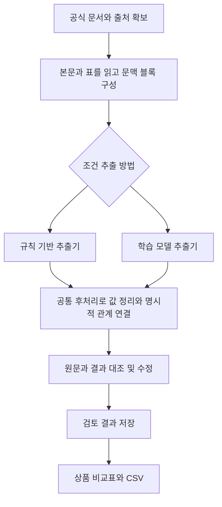

# 카드봐줘체리 · Card Cherry

**카드사 담당자의 경쟁상품 조사를 돕는 혜택 조건 추출·검토·비교 AI**

카드봐줘체리는 카드사의 공식 상품 자료에서 혜택 조건을 찾아 비교표 초안을 만들고, 사용자가 원문을 확인하며 수정한 뒤 조사자료로 활용하도록 돕는 프로젝트입니다.

우리가 해결하려는 문제는 **여러 문서에 흩어진 조건을 찾아 같은 기준으로 정리하고, 그 조건이 어느 혜택에 적용되는지 반복해서 확인해야 하는 부담**입니다.

현재는 기획 및 개발 착수 단계입니다. 아래 기능은 구현할 계획이며, 데이터 수량과 성능 수치는 실측 결과가 아닌 목표입니다. 이 README는 팀이 문제·해결 방법·검증 기준을 함께 이해하기 위한 기준 문서입니다.

## 1. 누가 어떤 상황에서 사용하는가

주요 사용자는 **카드사 상품기획·시장조사 담당자**입니다.

담당자가 새 상품을 기획하거나 기존 상품을 개선하려면 경쟁상품의 혜택을 조사해야 합니다. 예를 들어 편의점 혜택을 비교하려면 할인율뿐 아니라 다음 조건까지 확인해야 합니다.

- 어떤 업종과 거래에 적용되는지
- 전월에 얼마를 사용해야 하는지
- 월·건별 한도가 얼마인지
- 여러 혜택이 한도를 공유하는지
- 어떤 거래가 실적 계산에서 빠지는지
- 어떤 거래에는 할인·적립이 적용되지 않는지

필요한 내용은 상품 자료의 본문, 표, 공통 유의사항과 각주에 나뉘어 있을 수 있습니다. 담당자는 이를 찾아 표로 옮기고, 누락이나 잘못된 연결이 없는지 다시 확인해야 합니다.

카드사 대외활동에서 접한 경쟁상품 비교 업무가 기획의 출발점입니다. 다만 현업의 조사시간이나 오류 발생 규모를 측정한 상태는 아닙니다. 도구가 실제로 부담을 줄이는지는 이번 프로젝트에서 검증할 질문입니다.

## 2. 문제가 되는 지점을 예시로 이해하기

다음은 설명을 위해 직접 만든 **가상 카드 A의 문구**입니다. 실제 상품 조건이나 성능 평가 자료가 아닙니다.

> 편의점 결제 시 10%, 카페 결제 시 5% 할인됩니다.  
> 전월 이용실적 30만 원 이상인 경우 제공됩니다.  
> 편의점과 카페 할인은 합산하여 월 최대 5천 원까지 제공됩니다.  
> 상품권 구매금액은 전월 실적에서 제외됩니다.  
> 간편결제 거래에는 할인이 적용되지 않습니다.

이 문구를 정리하면 다음과 같은 결과가 필요합니다.

| 혜택 대상 | 할인율 | 전월 실적 | 월 할인한도 |
| --- | --- | --- | --- |
| 편의점 | 10% | 30만 원 이상 | 편의점·카페 합산 5천 원 |
| 카페 | 5% | 30만 원 이상 | 편의점·카페 합산 5천 원 |

두 혜택에는 **같은 한도가 적용**됩니다. 따라서 편의점과 카페에 각각 독립적인 5천 원 한도가 있는 것처럼 정리하면 잘못된 비교가 됩니다.

실적 제외와 혜택 제외도 다릅니다. 상품권 구매금액이 실적에 포함되는지와 간편결제 거래에 할인이 적용되는지는 서로 다른 조건으로 기록해야 합니다.

이 예시에서 해결할 문제는 다음과 같습니다.

1. 필요한 조건을 빠짐없이 찾는다.
2. 조건의 유형과 금액·단위를 구분한다.
3. 조건이 적용되는 혜택과 범위를 연결한다.
4. 사용자가 그 판단의 원문 근거를 확인할 수 있게 한다.

**숫자를 찾는 것, 숫자의 의미를 구분하는 것, 조건을 올바른 혜택에 연결하는 것은 각각 다른 작업입니다.**

## 3. 우리가 만들 결과물

사용자는 지원하는 공식 문서를 선택하거나 등록하고, 다음 흐름으로 조사표를 작성합니다.

1. 시스템이 공식 문서에서 혜택 조건을 찾아 초안을 만듭니다.
2. 사용자가 추출값과 원문 근거를 함께 확인합니다.
3. 잘못된 값이나 연결 관계를 수정하고 검토 결과를 저장합니다.
4. 여러 상품의 조건을 같은 항목으로 비교합니다.
5. 조건과 출처, 확인·검토 상태가 남는 CSV를 내보냅니다.

화면에서 조건을 선택하면 해당 내용의 원문을 찾을 수 있도록 연결할 계획입니다. 원문, 최초 예측, 사람의 수정 결과를 구분해 보존합니다.

최종 목표는 다음과 같습니다.

> **공식 카드 자료의 혜택 조건을 원문 근거와 함께 정리하고, 사람이 검토하여 경쟁상품 조사표를 완성할 수 있는 시스템을 만든다.**

## 4. 어디까지 개발하는가

| 항목 | 초기 개발 범위 |
| --- | --- |
| 주요 사용자 | 카드사 상품기획·시장조사 담당자 |
| 대상 상품 | 일반 신용카드 12개 상품군을 목표로 선정 |
| 선정 기준 | 공개 인기순위를 참고하되 공식 자료 접근성·이용조건·조건 유형을 함께 확인 |
| 대상 혜택 | 온·오프라인 결제에 적용되는 정률 할인과 포인트 적립 |
| 입력 자료 | 카드사 공식 상품 안내 페이지와 상품설명서 PDF |
| 출력 | 조건 초안, 원문 근거, 수정·검토 이력, 상품 비교표와 CSV |

인기순위는 실제 이용량이나 시장 대표성을 의미하지 않습니다. 최종 상품 목록과 확보 수량은 수집 단계에서 확정합니다.

추출할 기본 항목은 여섯 가지입니다.

| 항목 | 라벨 | 찾으려는 내용 |
| --- | --- | --- |
| 대상 | `TARGET` | 혜택이 적용되는 업종·가맹점 등 |
| 혜택 비율 | `RATE` | 할인율·적립률 |
| 전월 실적 | `SPEND` | 혜택을 받기 위한 전월 이용 조건 |
| 혜택 한도 | `LIMIT` | 월·건별 등 혜택 제한 조건 |
| 실적 제외 | `SPEND_EXCL` | 전월 실적 계산에서 제외되는 거래 |
| 혜택 제외 | `BENEFIT_EXCL` | 할인·적립을 받을 수 없는 거래 |

결제 경로, 혜택 종류, 한도의 전용·공유 여부 등 비교에 필요한 정보도 별도 속성과 검토 정보로 관리합니다. 이 정보가 모두 여섯 라벨만으로 자동 결정되는 것은 아닙니다.

플랫폼 제휴카드, 대화형 챗봇, 개인별 카드 추천, 실제 소비내역에 따른 할인액 계산은 초기 개발 범위에 포함하지 않습니다. 정액 혜택이나 복잡한 중복 조건은 지원 범위와 검토 필요 사항을 구분합니다. 원과 포인트를 근거 없이 환산하거나 카드의 전체 우열 순위를 만들지 않습니다.

## 5. 시스템은 어떻게 문제를 해결하는가

규칙과 모델은 비교 실험에서 서로 바꿔 사용하는 추출기입니다. 최종 운영 방식은 평가 결과를 보고 정합니다.

### 문서를 읽고 조건 블록 만들기

우리 추출 모델은 문서에서 꺼낸 텍스트를 입력으로 받습니다. 먼저 본문과 표를 읽고, 제목·행과 열의 헤더·필요한 각주를 보존해 조건을 이해할 수 있는 단위로 묶습니다. 이 단위를 **조건 블록**이라고 부릅니다.

예를 들어 `30만 원 / 10% / 5천 원`만 떼어 놓으면 의미를 구분하기 어렵습니다. 각각의 실적·비율·한도를 설명하는 주변 문맥을 함께 남겨야 합니다.

정리한 입력에서 보존 원문의 블록과 문자 위치로 돌아갈 수 있도록 대응 정보를 관리합니다. 표를 잘못 읽거나 필요한 각주를 놓치면 모델만으로 복구하기 어렵기 때문에, 문서 처리 오류도 별도로 확인합니다.

### 모델이 조건 구간 찾기

모델은 입력에서 **어느 부분이 여섯 조건 중 무엇에 해당하는지** 찾습니다.

한국어 사전학습 인코더에 토큰 분류 층을 붙여 카드 조건에 맞게 추가 학습할 계획입니다. KoELECTRA-Small은 초기 후보이며 추출 성능·CPU 처리시간·메모리를 확인한 뒤 최종 모델을 정합니다.

토큰은 모델이 읽는 단위입니다. 각 유형의 시작을 뜻하는 B, 이어지는 부분을 뜻하는 I와 조건 밖의 O를 사용하므로 태그는 `6 × 2 + 1 = 13개`입니다. 태그를 원문 위치에 대응시켜 조건 구간을 복원합니다.

### 규칙으로 값과 명확한 관계 정리하기

후처리는 추출된 `30만 원 이상`을 금액 `300000`, 단위 `원`, 연산자 `이상`처럼 정리합니다. 기간과 단위도 보존합니다.

개별 혜택의 참조 문구와 공통 조건의 대상을 명확히 확인할 수 있을 때만 관계를 연결합니다. 같은 금액이 등장한다는 이유만으로 공유 한도로 묶지 않습니다. 공통 한도는 여러 혜택이 같은 한도 정보를 참조하도록 표현합니다.

### 사람이 근거를 확인하고 수정하기

사용자는 값뿐 아니라 조건의 소속과 적용 범위를 확인합니다. 불명확한 부분은 검토 대상으로 남기고, 수정 전 예측과 수정 후 결과를 구분해 저장합니다.

## 6. AI를 사용하는 이유와 맡기지 않는 판단

금액과 퍼센트는 규칙으로 찾을 수 있습니다. 다만 표현이 달라지거나 같은 금액이 실적과 한도로 각각 등장하면 주변 문맥을 함께 봐야 합니다. **학습 모델이 이런 조건 구간을 규칙보다 더 잘 찾는지**가 검증할 질문입니다.

| 구성 | 맡을 일 | 별도로 확인할 부분 |
| --- | --- | --- |
| 학습 모델 | 문맥을 이용해 조건 구간과 유형 추출 | 혜택 간 관계를 모두 자동 판단하는 것은 아님 |
| 추출 규칙 | 표현·패턴·문맥 키워드로 조건 추출 | 모델 비교를 위한 Baseline으로 충분히 보완 |
| 공통 후처리 | 금액·단위·연산자 정리, 명확한 관계 연결 | 불명확한 관계는 자동 확정하지 않음 |
| 사람 | 원문 대조, 오류 수정, 모호한 조건 검토 | 검토 효과도 시간과 최종 오류로 평가 |

모델을 사용했다는 사실만으로 성능 향상을 주장하지 않습니다. 규칙보다 나아진 점을 확인하지 못하면 그 결과와 오류 원인도 보고합니다.

특히 공유 한도 예시의 모든 문제를 모델 하나가 해결하는 구조는 아닙니다. **모델의 기여는 조건 추출 실험으로, 시스템 전체의 기여는 조사 작업 실험으로 나눠 확인합니다.**

## 7. 데이터와 정답은 어떻게 만드는가

### 공식 자료 확보

공식 상품 페이지·상품설명서·공통 유의사항에서 필요한 자료를 확보합니다. 초기에는 소규모 수동 확인과 공식 다운로드를 우선하고, 자동수집은 이용조건과 수집 정책을 확인한 범위에서만 검토합니다.

상품·문서 식별자, 출처 URL, 수집일, 버전과 확인 가능한 적용 시점을 기록합니다. 원문 파일의 해시도 기록해 같은 자료인지 대조할 수 있게 합니다.

공개 열람 가능성과 학습·자동수집·원문 재배포 가능성은 구분해 확인합니다. 고객 거래내역·개인 명세서·내부 업무자료는 수집하지 않습니다.

### 정답 주석

사람이 블록에서 조건의 **유형과 원문 범위**를 표시합니다. 이를 정답 주석 또는 라벨링이라고 부릅니다.

예를 들어 실적 조건에서 금액만 선택할지, `이상`과 같은 기준까지 포함할지를 지침에 정해야 합니다. 단순 BIO 방식으로 중첩 조건을 직접 표현할 수 없는 경우의 주석 우선순위도 합의합니다.

전체 **250~400개 블록** 구축이 목표입니다. 초기 **30~50개 블록**은 두 사람이 독립 주석하고 차이를 조정하며 기준을 보완합니다. 문구를 복제하거나 문장을 잘게 쪼개 수량만 늘리지 않고, 유형별 사례와 상품별 분포를 확인합니다.

추출 정답과 함께 정규화 값, 적용 혜택, 한도 범위를 검수할 기준도 기록합니다. 해결되지 않은 사례의 보류 기준은 최종 시험 전에 정하고, 보류 건수와 이유를 보고합니다.

### 학습과 최종 시험 분리

| 구분 | 상품군 계획 | 용도 |
| --- | --- | --- |
| 학습 | 7개 | 모델 학습과 규칙 개발 |
| 검증 | 2개 | 모델·학습 설정·규칙 선택 |
| 시험 | 3개 | 선택이 끝난 결과의 최종 평가 |

같은 상품의 HTML·PDF·개정본과 유사 변형은 같은 집합에 둡니다. 다른 상품 사이에도 반복 문구와 공통 양식이 있을 수 있으므로 중복 정도를 확인합니다.

여기서 상품군은 같은 카드의 PDF·HTML·개정본과 유사 변형을 묶어 나누는 단위입니다. 분할은 학습 전에 고정합니다. 파일럿 개발에 반복 사용하는 상품은 학습 쪽에 배정하고, 시험 결과를 보며 모델이나 규칙을 보완하지 않습니다. 사전학습 모델을 사용하더라도 이 데이터 수량으로 충분하다는 보장은 없으며, 시험 3개 상품군의 결과를 시장 전체로 일반화하지 않습니다.

## 8. 성능 비교와 효과 검증

성능 비교는 개발 마지막에 점수만 계산하는 작업이 아닙니다. 데이터와 시스템을 만드는 단계부터 다음 두 질문에 답하도록 설계합니다.

### 비교 1 학습 모델이 조건을 더 잘 찾는가

비교 대상은 **규칙 기반 추출기와 학습 모델 추출기**입니다.

- 두 방법에 같은 본문·제목·표 헤더와 지원 범위를 제공합니다.
- 금액 정규화와 명시적 관계 연결에는 같은 후처리를 적용합니다.
- 규칙도 주변 문맥과 금융 표현을 활용하도록 보완합니다. 숫자만 찾는 약한 규칙을 비교 대상으로 두지 않습니다.
- 두 방법의 설정은 학습·검증 자료에서 정하고 최종 시험 전에 고정합니다.
- 사람이 수정하기 전 예측을 같은 정답 자료와 비교합니다.

주요 지표는 **Strict Span Micro-F1**입니다. 조건 유형과 원문의 시작·끝 범위가 모두 맞아야 정답으로 세고, 전체 정답·오탐·누락 수를 합쳐 계산합니다. 유형별·상품군별 결과와 실제 오류 수도 함께 보여줍니다.

F1은 조건 구간 추출 점수입니다. 금액·단위의 정규화와 혜택 소속, 공유 한도 연결은 별도로 평가합니다. 사람의 정답 구간을 공통 후처리에 넣어보면 추출 오류와 후처리 오류를 나누어 확인할 수 있습니다.

### 비교 2 실제 조사 작업에 도움이 되는가

| 작업 조건 | 확인할 효과 |
| --- | --- |
| 원문을 읽고 사람이 조사표 작성 | 기존 수작업의 시간과 최종 오류 |
| 규칙 결과를 제공하는 검토 도구 사용 | 규칙 초안과 검토 도구를 사용한 효과 |
| 모델 결과를 제공하는 같은 검토 도구 사용 | 규칙 대신 학습 모델을 사용한 추가 효과 |

규칙 도구와 모델 도구는 화면·수정·저장·비교·CSV 기능을 같게 두고 추출기만 바꿉니다. 수작업과 도구 사용에도 같은 필수 항목과 완료 기준을 적용합니다.

같은 문서를 반복해서 봐서 빨라지는 영향을 줄이도록 난도가 비슷한 서로 다른 과제와 수행 순서를 배정합니다. 참여자 수·사전 지식·과제·수행 순서·결과를 기록합니다. 팀 내부의 소규모 평가는 예비 평가로 표시합니다.

완료시간뿐 아니라 수정량과 최종 누락·중요 오류를 함께 봅니다. 중요한 오류에는 잘못된 한도 공유 관계, 실적 제외와 혜택 제외의 혼동처럼 비교 해석을 바꾸는 사례를 포함하고 판정 기준을 미리 정합니다.

미확인을 늘려 오류만 줄이는 결과를 구분하기 위해 자동 채움률도 확인합니다. 평가할 필수 항목의 분모를 먼저 정하고, 미확인을 채운 값으로 세지 않습니다. 원문에 명시된 없음도 근거가 있어야 합니다.

### 개발 목표와 측정 조건

| 지표 | 현재 목표 또는 확인 방법 |
| --- | --- |
| 추출 Strict Span Micro-F1 | 0.80 이상 목표 |
| 규칙 대비 추출 F1 차이 | 절대 0.03 상승을 도전 목표로 설정 |
| CPU 블록 처리시간 | 모델 로딩·준비 실행 후 배치 1, 입력 256토큰 이하에서 p95 5초 이하 목표 |
| 문서 전체 실행 | 최초 로딩·문서 전체 처리시간·메모리 별도 측정 |
| 정리·연결 품질 | 정규화 오류, 혜택 소속·한도 범위 오류와 처리 범위 기록 |
| 조사 작업 | 완료시간·수정량·자동 채움률·최종 누락과 중요 오류 비교 |

**모든 수치는 목표이며 아직 실측 성과가 아닙니다.** 파일럿에서 Baseline 성능과 주석 난도를 확인해 목표의 현실성을 검토하되, 시험 결과를 본 뒤 유리하게 바꾸지 않습니다.

블록 처리시간의 측정 구간은 토큰화·추론·공통 후처리로 고정하고, 장비·CPU 스레드 수·반복 횟수를 기록합니다. p95는 측정값의 95퍼센트가 그 값 이하라는 뜻이며 최대시간 보장이 아닙니다. 5초는 문서 전체 처리 목표가 아닙니다.

## 9. 잘못된 결과를 다루는 원칙

| 상황 | 처리 원칙 |
| --- | --- |
| 조건을 찾지 못함 | 미확인으로 남기며 없음이나 0으로 채우지 않음 |
| 원문에 없음·무제한이 명시됨 | 해당 근거와 함께 명시된 내용으로 기록 |
| 조건의 소속이 불명확함 | 임의로 연결하지 않고 검토 대상으로 남김 |
| 처리 실패나 지원 밖 패턴이 확인됨 | 원문과 확인된 사유를 보존해 안내 |
| 사람이 값을 수정함 | 최초 예측을 보존하고 수정 결과를 별도 기록 |
| 원문 버전이 변경됨 | 이전 검토 결과의 재확인 필요 여부를 표시 |

조건의 확인 상태와 사람의 검토·승인 상태는 별도로 관리합니다. 승인한 결과에도 미확인이 남을 수 있으며, 이를 비교표나 CSV에서 숨기지 않습니다.

모델이 놓친 모든 조건이나 모든 미지원 표현을 자동으로 감지할 수 있다고 보장하지 않습니다. 이러한 누락은 독립 정답과 사용자 검토를 통해 확인해야 합니다.

## 10. 첫 구현 목표와 최종 완료 기준

첫 구현 목표는 다음 한 흐름입니다.

> **지원하는 공식 문서 한 건에서 조건 초안을 만들고, 원문을 확인하며 수정한 결과를 저장해 CSV로 내보낸다.**

초기에는 규칙 추출기로 흐름을 연결하고 모델 실험을 병행합니다. 개발용 합성 예시는 기능 연결에 사용할 수 있지만, 이를 실제 문서에 대한 성능 근거로 제시하지 않습니다.

최종 완료 여부는 다음으로 확인합니다.

- [ ] 확보한 공식 자료와 지원 범위, 출처·버전을 기록했다.
- [ ] 조건 추출부터 근거 확인·수정·비교·CSV까지 작동한다.
- [ ] 공유 한도와 제외 조건을 구분하고 불명확한 결과를 검토할 수 있다.
- [ ] 최초 예측과 수정·검토 결과를 구분해 보존한다.
- [ ] 고정한 시험 자료에서 규칙과 모델을 같은 조건으로 비교했다.
- [ ] 조사 작업의 시간과 최종 오류를 함께 평가했다.
- [ ] 실제 성능, 실패 사례, 자원 사용과 재현 절차를 보고했다.

최종 산출물은 웹 서비스, 조건 비교표·CSV, 평가 보고서, 공개 가능한 코드와 주석 지침·재현 자료입니다. 원문·가공 데이터·가중치의 공개 범위는 각각 이용조건을 확인해 정하며, 코드의 공개 라이선스도 별도로 확정합니다.

실제 카드사 도입 효과는 더 많은 상품과 개정 문서, 현업 사용자와 운영 환경에서 추가 검증해야 합니다. 이번 프로젝트는 정해진 자료 범위에서 조건 추출과 조사 보조 효과를 검증하는 프로토타입을 목표로 합니다.

## 11. 팀이 함께 설명할 수 있어야 하는 내용

프로젝트의 각 작업은 다음 네 질문에 연결돼야 합니다.

1. **무슨 문제를 푸는가?** 흩어진 혜택 조건을 찾아 같은 기준으로 정리하고 적용 관계를 확인하는 부담을 다룹니다.
2. **어떻게 해결하는가?** 문서 처리, 조건 추출, 규칙 후처리와 사람의 근거 검토를 연결합니다.
3. **AI는 어디에 기여하는가?** 표현과 문맥을 활용해 조건 구간을 찾으며, 규칙 대비 추가 효과를 검증합니다.
4. **잘 만들었는지 어떻게 아는가?** 추출 성능과 실제 조사 작업의 시간·최종 오류를 나눠 비교합니다.

첫 착수에서는 지원 문서 한 건과 사람이 만든 정답 예시, 조건 블록·주석 기준, 공통 입출력 형식을 먼저 합의합니다. 역할별 상세 작업과 일정은 이 기준을 공유한 뒤 별도로 구체화합니다.
